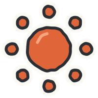
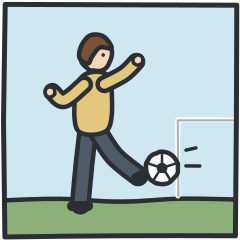

# デザイン設計書 ― はれ？ あめ？ よていづくり（weatherplan）

## 1. テーマ
**「わたしの てちょう ― 1しゅうかんの よていと てんきシール」**

中学生が使う リングとじの手帳（スケジュール帳）を ひらいた見た目。背景は深いみどりの布の表紙、問題は方眼のページの上。
天気マークと用事は **手で切ったシール**（白いふち＋太めの手描き線）として、ページの「1しゅうかんの らん」に はっていく。
- 主役のモチーフ: **週のらん（月〜日の7マス）に はる 天気シール**。予報を読む → 用事シールを はる、という動きが学習そのもの
- 案内役: 手帳を かかえた せんぱい（`guide.svg`。マスタードのカーディガン）。中学生向けに、頭身は低くしすぎない。幼い動物キャラや絵文字は使わない
- 飾りは マスキングテープ・リング・えんぴつ だけ。問題エリアの上には置かない
- 土日を赤・青で書く カレンダーの習慣は **使わない**（赤＝はれ、青＝あめ の意味とぶつかるため。曜日の文字はすべて ink）

## 2. 色（16進）
### 土台（4色＋主色）
| 用途 | 変数 | 色 | コントラスト |
|---|---|---|---|
| 背景（布の表紙） | `--c-cover` | `#3B5747` | — |
| 表紙の上の文字（進み具合） | `--c-cover-text` | `#F6F1E4` | 表紙の上 7.0:1 |
| ページ | `--c-page` | `#FCFAF4` | — |
| 押せる物の地（シールの白） | `--c-card` | `#FFFFFF` | — |
| 方眼の線（飾り） | `--c-grid` | `#E6EAE6` | 文字の下には出さない（問題文などは地をぬる） |
| 文字・線 | `--c-ink` | `#2B2F33` | ページ 12.9:1／どの色つきの地でも 10:1 以上 |
| 補足の文字 | `--c-ink-soft` | `#53595F` | ページ 6.8:1。**ページ・白の上だけで使う。色つきの地・テープの上では使わない** |
| マスキングテープ | `--c-tape` | `#E4C77E` | 文字はのせない（`.week-tag` だけ ink 8.2:1） |
| 主色（はじめる・つぎへ・せいかい） | `--c-primary` | `#2E5E4E` | 白文字 7.4:1 |
| 主色のうすい地 | `--c-primary-bg` | `#E2EDE6` | ink 11.2:1 |

### 決まった意味の色（lesson-plan どおり。**色＋形＋ことば** の3つで伝える）
| 意味 | 本体の色 | こい色 | うすい地（マスの地） | 形 | ことば |
|---|---|---|---|---|---|
| はれ | `#E0663A` | `#9A3A18` | `#F8DCCB` | 赤い **まる**＋光の **点8つ** | はれ |
| はれ ときどき くもり | — | — | はれ地／くもり地を **ななめに半分** | **まる（右上・小）＋くも（手前）** | はれ と くもり |
| くもり | `#A9AFB5` | `#50575E` | `#E1E3E6` | ふわふわの **くも だけ** | くもり |
| くもり 一時雨 | — | — | くもり地／あめ地を **ななめに半分** | **くも（左上）＋かさ（手前）** | くもり／あめ かも |
| あめ | `#3D7DBE` | `#1F4E7C` | `#D4E3F2` | **かさ＋しずく**（くもなし） | あめ |
| そと | `#A8D3E6` | `#1E5F7C` | `#D5EAF3` | **あおぞらと 木** | そと |
| なか | `#B7865A` | `#6B4321` | `#EEDFCB` | **やねの ある 家**（かべ紙の しま） | なか |

- 5つの天気マークは、白黒でも **まる／まる＋くも／くも／くも＋かさ／かさ＋しずく** で見分けられる
- どの地の上でも文字は `--c-ink`（10:1以上）。こい色の上に白文字を置くときも 7:1以上
- **せいかい** ＝ みどりの太いわく＋**チェックのスタンプ**（stamp-good.svg）＋「せいかい！」。**もういちど** ＝ 点線のわく＋**むしめがね**（stamp-retry.svg）＋「もういちど みてみよう」。赤・×は使わない（赤は「はれ」の色）

## 3. フォント（`fonts/` に同梱。ネットがなくても同じ見た目）
| 用途 | ファミリー（左から順に使う） | ファイル |
|---|---|---|
| 本文・問題・ボタン | `"Zen Maru Gothic"`(500/700), `"BIZ UDPGothic"`, `"Hiragino Maru Gothic ProN"`, `"UD Digi Kyokasho NK-R"`, `"Yu Gothic UI"`, `"Meiryo"`, sans-serif | `fonts/ZenMaruGothic-Medium.woff2`・`-Bold.woff2` |
| 見出し（手帳にペンで書いた感じ） | `"Yusei Magic"`, `"UD Digi Kyokasho NK-B"`, `"YuKyokasho"`, `"Hiragino Maru Gothic ProN"`, `"BIZ UDPGothic"`, sans-serif | `fonts/YuseiMagic-Regular.woff2` |

- ライセンス: SIL OFL（`fonts/OFL.txt`）。かな・英数字・記号・JIS第1水準漢字にしぼって軽くしてある（3つで約1.7MB）。それ以外の漢字は代替フォントで出る
- `file://` で読みこめることを Chromium で確認済み
- 文字の大きさ（1920×1080 基準）: 問題文 48px（行間 1.85。ふりがなが重ならない）／選択肢 40px／本文・ふきだし 32px／**いちばん小さい文字・ふりがな・数字キー印 28px以上**
- 見出しの手書き風（Yusei Magic）は、ステップ名・タイトル・「せいかい！」・週ラベル・ステップクリアだけ。問題文や選択肢には使わない
- 文は **分かち書き**（ことばの間にスペース）で書く。CSS は `word-break: keep-all` なので、スペースの所でだけ改行する。**スペースのない長い文は改行できずにはみ出すので、かならず分かち書きにする**

## 4. 画面サイズ
- `#app` は 1920×1080 の固定キャンバス。**game.js で次を必ず入れる**（JSが無いときは CSS の zoom で段階的に縮む）
```js
function fitApp(){
  const s = Math.min(innerWidth/1920, innerHeight/1080);
  document.documentElement.style.setProperty('--app-scale', s);
}
document.documentElement.classList.add('js-fit');
addEventListener('resize', fitApp); fitApp();
```
- `#stage3d` は `#app` の **外**（`position:fixed; inset:0; z-index:50; pointer-events:none`）。`Motion3D.celebrate(x, y)` には `getBoundingClientRect()` の画面座標（px）をそのまま渡す
- この設計書の座標はすべて 1920×1080 基準（`#app` の中の座標）。1280×720 では ×0.667 で縮むだけで、配置は同じ（見本で確認済み）

## 5. 画面の配置（全ステップで同じ位置）
```
┌──────────────────────────────────────────────────────────────────────────── 1920 ┐
│[#step-tag ステップ名] #progress「ステップ 1／3」「2もんめ／ぜんぶで 5もん」●◎○○○   #settings [おと][うごき][ひとやすみ][もどる] │ y 26–158
│                                                     （テープ）                                                  │
│ ◯ ┌─ .board.paper (#board)  x104 y186  1776×870 ─────────────────────────────────────────────────┐ │
│ ◯ │ #question-area  x160 y216  1300×172                                  │ #side  x1504 336×810  │ │
│ ◯ │   .q-text 問題文 48px（ruby）                         [#btn-read よむ 168×128] │ #feedback (200)       │ │
│ リ│ - - - - - - - - - - - - - - - - - - - - - - - - - - - - - - - - - - - │  スタンプ＋せいかい！  │ │
│ ン│ #visual  x160 y388  1300×318   絵・カード・週の表                       │ #speech ふきだし       │ │
│ グ│                                                                        │                       │ │
│ ◯ │ #choices x160 y706  1300×320                                           │ #guide あんない役       │ │
│ ◯ │   #choice-list  [1 選択肢] [2 選択肢] [3 選択肢]（間48px）  [#btn-next] │  (300px)              │ │
│ ◯ └──────────────────────────────────────────────────────── #btn-next x1160 y878 300×140 ──┘ │
└──────────────────────────────────────────────────────────────────────────────────────────┘
```
- `#btn-next`（つぎへ）は **どの画面でも x1160 y878（300×140）**。`#choices` の右下に下ぞろえ。クリア画面の `#btn-clear-next` も同じ位置
- `#feedback`（合図）は **右の列の上**。`#visual` には重ねない（前回、ヒントの絵が隠れた点の対策）。出さないときも場所は空けたまま（`visibility`）
- 問題中は `#visual`・`#choices` の上で何も動かさない。動くのは、子どもが押したときの反応と、ゆっくりのヒントだけ
- 「くらべる」「まとめ」は `#board` に `data-layout="wide"` をつけ、`#visual` を 488px に広げる（`#choices` は 150px で、つぎへ だけ）

### 各画面
| 画面 | 要素 | 配置・きまり |
|---|---|---|
| タイトル `#screen-title` | `.paper.title-page`（左。−1度かたむいた手帳のページ、`.rings` つき）に `h1.title-logo`（`<span>はれ？ あめ？</span><span>よていづくり</span>`）、`p.title-sub`「1しゅうかんの てんきを みて、よていを きめよう」、`.title-week`（飾りの週。`div.day-cell` ×7、しゅう1の天気）、`.title-actions` に `#btn-start.btn-primary`「はじめる」・`#btn-steps.btn-secondary`「ステップを えらぶ」。`img.title-pencil`、右下に `img.title-guide` | 中央寄せの定型にしない。右側 x1100–1580 は **3Dの場所**（静止画の天気マークは置かない＝前回の「温度計が2本」の対策）。`#step-tag`・`#progress` は hidden |
| ステップを えらぶ | `.title-page` に `.is-picking` をつける → `.title-week`・`.title-actions` が消え、`.step-picker` の `button.btn-step` ×3（medal-step1〜3.svg＋ステップ名、`.key-num` 1〜3）が出る | もどるときは `.is-picking` をはずす |
| おてほん（`#screen-play` `data-mode="model"`） | 問題と同じ位置。`#speech` にせんぱいのことば。お手本の動き（カードが光る・箱に入る）が終わってから `#btn-next` を出す | `#btn-next` は `hidden` 属性で消す（CSSで `[hidden]{display:none !important}` 済み） |
| 問題（`data-mode="quiz"`） | 上の図 | |
| せいかい | 押した物に `.is-correct`、`#feedback` に `.feedback--good.is-show`（stamp-good.svg＋「せいかい！」）、`#speech` にほめことば、`#guide` の src を guide-happy.svg にして `.is-happy`。ほかの選択肢は `hidden` | 1.2秒後に `#btn-next`（自動で進めない） |
| もういちど（1回目） | 押した物に `.is-retry`、`#feedback.feedback--retry.is-show`（stamp-retry.svg＋「もういちど みてみよう」）、`#guide` を guide-thinking.svg＋`.is-thinking` | `#visual` のマークを少し大きく（`.wmark-part.is-glow` か `transform: scale(1.06)`） |
| ヒント（2回目） | lesson-plan の「ヒント」。正解でない物に `.is-dimmed`、正解に `.is-guide`。マークの一部を光らせるときは `.wmark-part.is-glow`（ほかは `.is-dim`） | 光は2.4秒に1回の ゆっくりした明暗。点滅しない |
| 答え（3回目） | 正解に `.is-guide`＋フォーカスを移す。`#speech`「いっしょに たしかめよう。○○だから △△だね」 | |
| ステップクリア `#screen-clear` | `.board.paper` の中に `.clear-wrap` > `img#clear-medal`（medal-step{n}.svg、x240 y271 380×380、中心 **(430, 461)**）＋`p.clear-text`「ステップ1 クリア！」＋`p.clear-sub`、`.clear-actions` > `#btn-clear-next.btn-primary`「つぎへ」 | 3Dの `stepClear(n)` と同時。WebGLが無くてもメダル画像で伝わる |
| ふり返り `#screen-result` | `.board.board--result.paper` > 左 `.result-left`（`h2.result-title`「さいごまで できたね！」、`ul.result-list > li.result-item`（medal＋`.label`）×3、`.result-actions` に `#btn-again.btn-primary`「もういちど あそぶ」・`#btn-pick.btn-secondary`「ステップを えらぶ」をたてに）、右 `.result-plan`（`p.plan-head`「きみの よていひょうが できたよ」＋`.week-table.week-table--plan`） | `#step-tag`・`#progress` は hidden |
| おやすみ `#rest-overlay` | 全面のページ色。icon-rest.svg＋「ひとやすみ しよう。いつでも もどれるよ」＋`#btn-resume.btn-primary`「つづける」 | `#btn-rest` で `.is-show`。音は止める。Esc でも閉じる |

### ステップごとの `#visual` と `#choice-list`
| ステップ | `#visual` | `#choice-list` |
|---|---|---|
| 1 問題 | `.wmark.wmark--{天気}`（280×280。下の「天気マークの組み立て」）。おてほんでは横に `span.mark-caption`「はれ」 | `button.choice.choice--weather`（380×260）×2〜3。中に `img.choice-icon`（weather-*.svg）＋`span.label`。Q5「ふるかも／ふらない」は `.label` だけでよい |
| 2 問題 | `.task-card`（task-*.svg＋`.task-name`）。**`.where-badge` は出さない**（答えになるため）。ヒントでは `.task-card` の前に `img.hint-scene`（box-soto.svg／box-naka.svg）を入れて、うしろに景色をうかべる | `button.choice.choice--box.soto`（box-soto.svg＋「そと」）、`.naka`（box-naka.svg＋「なか」）。600×290 ×2 |
| 2 まとめ（wide） | `.summary` > `.sort-box.soto` / `.sort-box.naka`（`.sort-head`＝badge＋「そと」、`.sort-items` に `.task-chip.task-chip--row`、`p.sort-note`） | 空（`#btn-next` だけ） |
| 3 曜日をえらぶ | `span.week-tag`「しゅう1」＋`.task-card`（task-*.svg＋`.task-name`＋**`img.where-badge`**＝badge-soto/naka） | `.choice-list.choice-list--week` に7マス。えらべる3つは `button.day-cell`（`.key-num` 1〜3）、ほかは `div.day-cell.is-off` |
| 3 どうして？ | `.pick-pair`: `.task-card` → `span.pick-arrow` → `div.day-cell.is-picked`（`.day-slot` に `.task-chip`） | `button.choice.choice--reason`（600×230）×2。絵は下の表 |
| 3 くらべる（wide・問4の前） | `.week-table`（曜日の見出し1回＋しゅう1の行＋しゅう2の行＋「かわった」の行）。かわった曜日（水・木・金・土）のしゅう2のマスに `.is-changed`、1つずつ順に `.is-guide`。土のマークは `.mark-swap` で入れかえ | 空（`#btn-next` だけ） |

**どうして？の絵（`.choice--reason` の `img.choice-icon`）**
| ことば | 絵 |
|---|---|
| はれだから | weather-hare.svg |
| あめだから／あめが ふるから | weather-ame.svg |
| あめが ふらないから | weather-hare-kumori.svg（かさが ない） |
| いえの なかで できるから／たてものの なかだから | badge-naka.svg（**家マーク**。ヒントで光らせる物） |

### マークアップの形（このとおりに作ると、CSSがそのまま効く）
```html
<!-- 天気マークの組み立て（ステップ1の #visual。パーツごとに光らせられる）。DOMの順＝うしろから -->
<div class="wmark wmark--hare-kumori">
  
  
</div>
<!-- パーツの組み合わせ: hare=sun ／ hare-kumori=sun,cloud ／ kumori=cloud ／ kumori-ame=cloud,umbrella ／ ame=umbrella,drops -->
<!-- 小さく出すだけのとき（マス・選択肢・カード）は 1枚の assets/weather-{天気}.svg を使う。見た目は同じ -->

<!-- 曜日のマス（押せるときは button、押せないときは div）。data-weather で地の色が決まる -->
<button class="day-cell" data-weather="hare" data-day="sun">
  <span class="key-num" aria-hidden="true">3</span>
  <span class="day-name"><ruby>日<rt>にち</rt></ruby></span>
  
  <span class="day-weather"><span>はれ</span></span>
  <span class="day-slot"></span>   <!-- 用事シールを入れる所。空なら出ない -->
  <span class="sr-only">にちようび、はれ</span>
</button>

<!-- 週の表（くらべる・ふり返り）: 8列のグリッド。1行目＝空＋曜日7つ、2行目＝しゅう1、3行目＝しゅう2 -->
<div class="week-table">
  <span></span><span class="wt-day"><ruby>月<rt>げつ</rt></ruby></span> …（7つ）
  <span class="week-tag">しゅう1</span><div class="day-cell" data-weather="hare">(day-name なし: day-mark＋day-weather＋day-slot)</div> …（7つ）
  <span class="week-tag">しゅう2</span> …（7つ）
  <span></span><span class="wt-note"><span>かわった</span></span> …（くらべる画面だけ。かわらない曜日は空の span）
</div>

<!-- 選択肢: ことばは かならず span.label 1つにまとめる（ruby と かなの間に すきまが出ない） -->
<button class="choice choice--weather"><span class="key-num" aria-hidden="true">1</span>
  <span class="label">はれ</span></button>

<!-- 用事シール（マス・まとめ・ふり返り） -->
<span class="task-chip"><span class="label">サッカー</span></span>
```

**マスの天気のことば（`.day-weather`。2行のときは span を2つ）**
| data-weather | `.day-weather` の中 | 読み上げ |
|---|---|---|
| hare | `<span>はれ</span>` | はれ |
| hare-kumori | `<span>はれ と</span><span>くもり</span>` | はれ ときどき くもり |
| kumori | `<span>くもり</span>` | くもり |
| kumori-ame | `<span>くもり</span><span>あめ かも</span>` | くもり いちじ あめ |
| ame | `<span>あめ</span>` | あめ |

曜日: 月 げつ／火 か／水 すい／木 もく／金 きん／土 ど／日 にち（`<ruby>` でふりがな）

## 6. 要素ID・クラス名 一覧（game-builder・motion-3d・sound-maker 共通）

### ID（ページに1つ）
| ID | 役割 |
|---|---|
| `#stage3d` | 3Dキャンバスを重ねる入れ物。`#app` の外。`pointer-events:none`、z-index 50、`aria-hidden="true"` |
| `#app` | 1920×1080 の画面本体（`--app-scale` で拡大縮小） |
| `#screen-title` / `#screen-play` / `#screen-clear` / `#screen-result` | 画面（`.screen`、表示中だけ `.is-active`） |
| `#topbar` | 上の帯（表紙の上） |
| `#step-tag` | ステップ名のラベル（1「てんきマークを よもう」2「そと？ なか？ わけよう」3「よていを たてよう」） |
| `#progress` | 進み具合（`p.progress-text` > `<span>ステップ 1 ／ 3</span><span>2もんめ ／ ぜんぶで 5もん</span>`、`ol.progress-dots > li.dot`） |
| `#settings` | 右上の設定ボタン群（4つ。x1280–1880 y26–158） |
| `#btn-sound` | おと あり／なし（`aria-pressed`。icon-sound-on / icon-sound-off。`.label` に `<span>おと</span><span>あり</span>`） |
| `#btn-motion` | うごき ふつう／すくなめ（`aria-pressed`。icon-motion / icon-motion-less） |
| `#btn-rest` | ひとやすみ（icon-rest。`<span>ひと</span><span>やすみ</span>`） |
| `#btn-back` | もどる（icon-back。タイトルへ） |
| `#board` | 問題画面のページ（`board paper`。`data-layout="wide"` で広い絵の段） |
| `#question-area` / `#q-text` | 問題エリア／問題文（`q-text`。`<ruby>漢字<rt>よみ</rt></ruby>`） |
| `#btn-read` | よむ（`read-btn`。icon-speaker。読み上げ中 `.is-reading`） |
| `#visual` | 絵・図エリア |
| `#choices` / `#choice-list` | 選択肢エリア／選択肢を入れる所（`choice-list`、ステップ3は `+ choice-list--week`） |
| `#btn-next` | つぎへ（x1160 y878 固定） |
| `#side` / `#feedback` / `#speech` / `#guide` | 右の列／合図（`aria-live="polite"`。中に img と `span.feedback-word`）／ふきだし（`speech`）／あんない役（`guide`。src を guide.svg・guide-happy.svg・guide-thinking.svg で切りかえ） |
| `#btn-start` / `#btn-steps` / `#step-picker` | はじめる／ステップを えらぶ／ステップの3ボタンの入れ物 |
| `#clear-medal` / `#btn-clear-next` | クリアのメダル／クリアの つぎへ |
| `#btn-again` / `#btn-pick` / `#btn-resume` | もういちど あそぶ／ステップを えらぶ（ふり返り）／つづける |
| `#rest-overlay` | おやすみ画面（`.is-show`） |

### クラス
| クラス | 役割 |
|---|---|
| `.screen` `.is-active` | 画面の切りかえ |
| `.paper` `.board` `.board--result` `.rings` `.tape .tape--tl/.tape--tr` | 手帳のページ・リング・テープ（`.rings` は `.board` の外に置く。タイトルでは `.title-page` の中） |
| `.dot` `.is-now` `.is-done` | 進み具合（未: 点線の丸／いま: テープ色の太い輪／済: 塗り＋チェック） |
| `.set-btn` | 設定ボタン（132×132） |
| `.label` | ボタン・カードの中の ことばを まとめる span（1つだけ） |
| `.q-text` `ruby` `rt` | 問題文とふりがな（rt は 28px以上・本文と同じ色）。`body.furigana-off` で rt を隠す（先生用） |
| `.read-btn` `.is-reading` | 読み上げボタン |
| `.choice` | 選択肢（共通。最小 240×200、となりと48px） |
| `.choice--weather` `.choice--box .soto/.naka` `.choice--reason` | 選択肢の種類 |
| `.choice-icon` `.box-art` | 選択肢の中の絵 |
| `.key-num` | 数字キー印（54px の白い丸に 30px の ink 文字。どの地でも 12:1以上）。`aria-hidden="true"` |
| `.is-selected` `.is-correct` `.is-retry` `.is-dimmed` `.is-guide` `.is-placed` | 選択肢・マスの状態 |
| `.feedback--good` `.feedback--retry` `.feedback--info` `.is-show` | `#feedback` の種類 |
| `.speech` `.guide` `.is-happy` `.is-thinking` | ふきだし・あんない役（少しはねる／首をかしげる） |
| `.wmark .wmark--{hare,hare-kumori,kumori,kumori-ame,ame}` `.wmark-part .wmark-part--{sun,cloud,umbrella,drops}` `.is-glow` `.is-dim` | 天気マークの組み立て・一部だけ光らせる |
| `.mark-caption` `.pointer` | マークの名前の札／指さしの三角 |
| `.task-card` `.task-name` `.where-badge` `.hint-scene` | 用事カード（大）／名前／そと・なかの しるし（ステップ3だけ）／ヒントの景色 |
| `.task-chip` `.task-chip--row` | 用事シール（小） |
| `.week` `.week-row` `.week-tag` | 週のならび・週ラベル（しゅう1／しゅう2） |
| `.day-cell` `[data-weather]` `.day-name` `.day-mark` `.day-weather` `.day-slot` | 曜日のマス |
| `.is-off` `.is-picked` `.is-changed` | えらべない／えらんだ（横長）／かわった |
| `.mark-swap .mark-old .mark-new` | マークの入れかわり（1.2秒。うごき すくなめでは すぐ入れかわる） |
| `.week-table` `.wt-day` `.wt-note` `.week-table--plan` | 2週を同じ列でならべる表（くらべる・ふり返り） |
| `.summary` `.sort-box .soto/.naka` `.sort-head` `.sort-items` `.sort-note` | ステップ2 まとめ |
| `.pick-pair` `.pick-arrow` `.visual-note` | ステップ3 どうして？の絵／矢じるし／一言そえる文 |
| `.btn-primary` `.btn-secondary` | 大きいボタン（最小 300×140） |
| `.title-page` `.title-logo` `.title-sub` `.title-week` `.title-actions` `.title-pencil` `.title-guide` `.is-picking` `.step-picker` `.btn-step` | タイトル |
| `.clear-wrap` `.clear-text` `.clear-sub` `.clear-actions` | ステップクリア |
| `.result-left` `.result-title` `.result-list` `.result-item` `.result-actions` `.result-plan` `.plan-head` | ふり返り |
| `body.reduce-motion` | うごき すくなめ（CSSのアニメ・トランジションを止める。ヒントは太いわくで残る） |
| `.sr-only` `.nowrap` | 読み上げだけ／改行しない |
| `html.js-fit` | fitApp() が動いている目じるし |

## 7. 素材（assets/ すべて自作SVG。いらすとやの絵は使っていない）
| ファイル | 内容 | 使う場所 |
|---|---|---|
| weather-hare / hare-kumori / kumori / kumori-ame / ame .svg | 天気シール5種（200×200。白いふち＋手描き線） | マス・選択肢・カード |
| wpart-sun / cloud / umbrella / drops .svg | 天気マークのパーツ（`.wmark` で重ねる） | ステップ1 の `#visual`、ヒントで一部を光らせる |
| task-piano / ensoku / cafe / study / reading / cinema / soccer .svg | 用事7種（240×240。①ピアノ ②えんそく ③カフェ ④べんきょう ⑥ほんを よむ ⑦えいがかん ⑧サッカー。⑤おつかいは使わない） | `.task-card`・`.task-chip` |
| box-soto.svg / box-naka.svg | そと（あおぞら・木・草）／なか（やねの家・かべ紙）560×240 | `.choice--box`、ステップ2のヒント `.hint-scene` |
| badge-soto.svg / badge-naka.svg | そと・なかの まるい しるし（96×96） | `.where-badge`、`.sort-head`、どうして？の家マーク |
| guide.svg / guide-happy.svg / guide-thinking.svg | あんない役のせんぱい（ふつう／よろこぶ・手を上げる／首をかしげる まゆ） | `#guide`、`.title-guide` |
| stamp-good.svg / stamp-retry.svg | チェックのスタンプ／むしめがね | `#feedback`、`.is-correct`・`.is-retry` の角 |
| medal-step1 / 2 / 3 .svg | クリアのシール（おひさま／そとと なか／よていひょう） | `#clear-medal`、`.btn-step`、`.result-item` |
| icon-speaker / sound-on / sound-off / motion / motion-less / rest / back / check .svg | 操作アイコン（ink の線） | `#settings`、`#btn-read` |
| rings.svg | リングのとじ具（64×120 をたてに くりかえす） | `.rings` |
| deco-pencil.svg | えんぴつ（飾り） | タイトル |

`img` の `alt` は、ことばが横にある物は空（`alt=""`）。絵だけで意味を持つ物（`#visual` の天気マーク・用事カードの絵）は「はれ の マーク」などを入れる。

## 8. 3D担当（motion-3d）向け
- **`THEME`**（`Motion3D.init(el, { theme: THEME })` で渡す。game.js にこのまま書く）
```js
const THEME = {
  page: 0xFCFAF4, cover: 0x3B5747, ink: 0x2B2F33, primary: 0x2E5E4E, tape: 0xE4C77E,
  sun: 0xE0663A, sunLight: 0xF2A57E, cloud: 0xA9AFB5, cloudLight: 0xCED2D6,
  rain: 0x3D7DBE, rainLight: 0x9CC0E4, soto: 0xA8D3E6, naka: 0xB7865A, grass: 0x8DB07A
};
```
- 質感: `MeshToonMaterial`（2〜3段のグラデーションマップ）＋輪郭は `EdgesGeometry` か裏面を少し大きくした ink 色（手描き線に合わせる）。光沢・金属・発光・ネオンは使わない。背景は透明（`alpha:true`）
- **モチーフと作り方**（どれも「白いふち（page色）のシール」を意識。小さな物は薄い板でよい）

| モチーフ | 立体の作り方 | 色 |
|---|---|---|
| おひさま（主役1） | `SphereGeometry`（半径0.5）を z方向に0.6倍につぶす＋まわりに小さな `SphereGeometry`（半径0.11）を **8つ** 円にならべる（半径0.85）。ゆっくり回る | sun、光の点も sun。ハイライトに sunLight |
| くも（主役2） | `SphereGeometry` を4〜5個（半径0.3〜0.45）横にならべて重ね、下を平らに（y を0.8倍）。ひとまとめの `Group` | cloud、上に cloudLight の小さな球 |
| かさ（主役3） | 布: `SphereGeometry(0.7, 8, 6, 0, 2π, 0, π/2)`（8面の半球）。1面おきに rain／rainLight。え: 細い `CylinderGeometry`＋下に `TorusGeometry` の半分（J の形）。先に小さな球 | rain / rainLight、え ink |
| しずく | `LatheGeometry`（しずくの輪郭を回す） | rainLight |
| 天気シールの紙ふぶき | `CircleGeometry`（半径0.07）と `PlaneGeometry`（0.08×0.12）を両面で。ひらひら回る | page / sun / rainLight / tape / primary / soto |
| クリアのシール | うすい `CylinderGeometry`（半径0.7・厚さ0.06、ふちを波形にするなら `Shape` を `ExtrudeGeometry`）。表に medal-step{n}.svg を `CanvasTexture` で貼る | 地 page、ふち tape（1）・grass（2）・rainLight（3） |
| 手帳のページ（クリアの台） | うすい `BoxGeometry`（2.2×1.6×0.03）＋上に方眼の `CanvasTexture`（なくてもよい） | page |
| マスキングテープの切れはし | うすい `BoxGeometry` を少しねじる | tape |

- 場面
  - **タイトル**（`setScene('title')`）: **x1100–1580・y240–960 の中だけ**（1920基準）で、おひさま・くも・かさが奥からふわっと出て、ゆっくり回りながら浮かぶ。カメラは少しだけ回り込む。左の手帳のページ（x97–1071）、右上の `#settings`（y≦158）、右下のせんぱい（x≧1610・y≧610）には **かからない**（浮かぶ動きの はば も見こむ。前回 設定ボタンに重なった点の対策）
  - **問題中**（`setScene('play')`）: 何も出さない。ずっと動く物は置かない
  - **せいかい** `celebrate(x,y)`: 押したボタンのまわりで 天気シールの紙ふぶき（30〜60枚）＋小さなおひさまが1つ ぽんと出る（1〜1.5秒）。`#side` の文字には かからないよう、半径300px以内
  - **まちがい** `encourage()`: 小さなくもが画面の右の列の上（x1520–1840・y420–600 あたり）で ふわっと1回 うなずく程度。雨・赤・×・ゆれは使わない
  - **ステップクリア** `stepClear(n)`: medal-step{n} のシールが くるっと回って、`#clear-medal` の中心 **(430, 461)**・直径380px の所に「ぺたっ」と はられる（2秒以内）。その後3Dのシールは消してよい（画像のメダルが残る）
  - **ふり返り**（`setScene('result')`）: 上の帯の左（**x120–1200・y30–150 は空いている**）に3つのシールを横にならべ（中心 x260・420・580、y92、直径100px以下）、1つずつ順に やわらかく明るくなる（1秒に1回以下）。ページの上には出さない
- 「うごきをへらす」: 回転・飛び出し・紙ふぶきを止め、シールは その場にふわっと出るだけ

## 9. 音と演出を出す場所（sound-maker・game-builder 向け）
| きっかけ | 音 `Sound.play()` | 3D `Motion3D` | 画面（CSS） |
|---|---|---|---|
| 「はじめる」 | `Sound.start()`（BGMを小さくフェードイン） | `setScene('play')` | |
| タイトル表示 | （まだ鳴らせない） | `setScene('title')` | |
| ボタン・マスを押した | `tap`（ぽん） | | `:active` で沈む |
| ステップ1・2 せいかい | `correct` | `celebrate(x,y)` | `.is-correct`、`#feedback.feedback--good.is-show`、`#guide` happy |
| ステップ3 曜日がせいかい | `correct` | `celebrate(x,y)` を小さく（紙ふぶき少なめ） | マスに `.is-correct` → どうして？へ |
| ステップ3 どうして？がせいかい | `correct` | `celebrate(x,y)` | `.is-correct`、`#feedback` |
| まちがい（1〜3回目） | `retry`（ぽわん。やさしい低め） | `encourage()` | `.is-retry`、`#feedback.feedback--retry`、`#guide` thinking |
| ヒントが光る | 鳴らさない | 何もしない | `.is-guide` / `.wmark-part.is-glow` |
| おてほんでカードが光る・箱に入る | `tap` | 何もしない | `.is-guide` → `.is-correct` |
| くらべる画面で かわった曜日が光る | 鳴らさない（静かに見る時間） | 何もしない | `.is-changed.is-guide`、`.mark-swap` |
| ステップクリア | `clear`（短いファンファーレ） | `await stepClear(n)` | `#screen-clear` |
| ふり返り | （BGMのみ） | `setScene('result')` | |
| おやすみ | BGMを止める（`Sound.stop()`）。もどったら元の設定で `start()` | 何もしない | `#rest-overlay.is-show` |
| 「おと なし」 | `Sound.setMuted(true)` | | `#btn-sound[aria-pressed=false]`、表示「おと なし」 |
- 曲のイメージ: 「朝の 天気予報の あとの、手帳を ひらく 時間」。テンポ 88〜92、ヘ長調、マリンバ（木琴）とチェレスタ（オルゴール）、やわらかいパッド。ドラムなし。中学生向けに、こどもっぽい はねるリズムは さける

## 10. 見やすさのチェック（このデザインで守っていること）
- 文字: いちばん小さい 28px（ふりがな・数字キー印も）、本文 32px、問題文 48px、行間 1.6以上（問題文 1.85）
- コントラスト: すべて 4.5:1以上（2章）。**色つきの地（天気のマス・そと／なか の箱・せいかいの地）の上の文字・ふりがなは ink**（10:1以上）。`--c-ink-soft` はページと白の上だけ。テープの上には文字を置かない（`.week-tag` は ink 8.2:1）
- 数字キー印 `.key-num`: 54px の白い丸に 30px の ink（12:1以上）
- ボタン: 選択肢 380×260・600×290・600×230、曜日のマス 164×300、設定 132×132、よむ 168×128、つぎへ 300×140。となりとの間 24〜48px
- 色だけにしない: 天気＝マークの形＋ことば、そと/なか＝絵（空と木／家）＋ことば、せいかい＝チェックのスタンプ＋ことば＋太いわく、もういちど＝むしめがね＋点線、えらべないマス＝斜線＋点線、かわった曜日＝太い点線わく＋「かわった」、進み具合＝塗り＋チェック
- 点滅なし。ヒントの明暗は2.4秒に1回。画面全体が光る演出なし
- `body.reduce-motion` と `prefers-reduced-motion` でCSSの動きを止める（ヒントは止まった太いわくで残る）。3Dは `Motion3D.setReducedMotion(true)`
- キーボード: 押せる物すべてに 6px の `:focus-visible` わく（ページの上はみどり、表紙の上は明るい色）。`.key-num` で1〜3キーを見せる

### 前回（angermanagement）の指摘への対策
| 前回の指摘 | このデザインでの対策 |
|---|---|
| `[hidden]` が `display` 指定で上書きされた | style.css の先頭に `[hidden]{display:none !important}` を入れた。ステップを えらぶ画面は クラス（`.is-picking`）で切りかえる |
| 色つきボタンの上の補足文字（rt・数字）が4.5に足りない | rt は `color: inherit`（いつも ink）。`.key-num` は白地に ink。`--c-ink-soft` を色つきの地で使わないきまりにした |
| 数字キー印が26px | 30px（54pxの丸） |
| 箱の中で「かえられ／る」とことばの途中で改行 | `body{word-break:keep-all}`、ボタンの幅は ことばが入る大きさで決めた。2行にするマスのことばは span を分けて `white-space:nowrap` |
| 合図の札がヒントの絵を隠した | `#feedback` は右の列の上。`#visual` に重ねない |
| ラベルの中の ruby と かなの間に すきま | ことばは `span.label` 1つにまとめる。`.task-chip` は絵と `.label` の2つだけ |
| タイトルの3Dが設定ボタンに重なった・静止画と3Dで温度計が2本 | 3Dの場所を x1100–1580・y240–960 に決めた。そこに静止画の天気マークは置かない |

## 11. 見本で確かめたこと
- 作業用の見本ページ（全画面）を Chromium で 1920×1080 と 1280×720 に出して、文字の はみ出し・重なりがないこと、同梱フォントが読みこまれること、`#btn-next` がどの画面でも同じ位置にあることを確かめた
